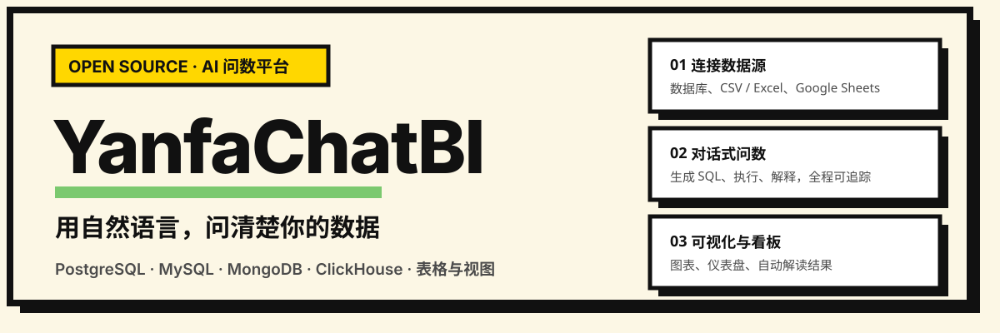
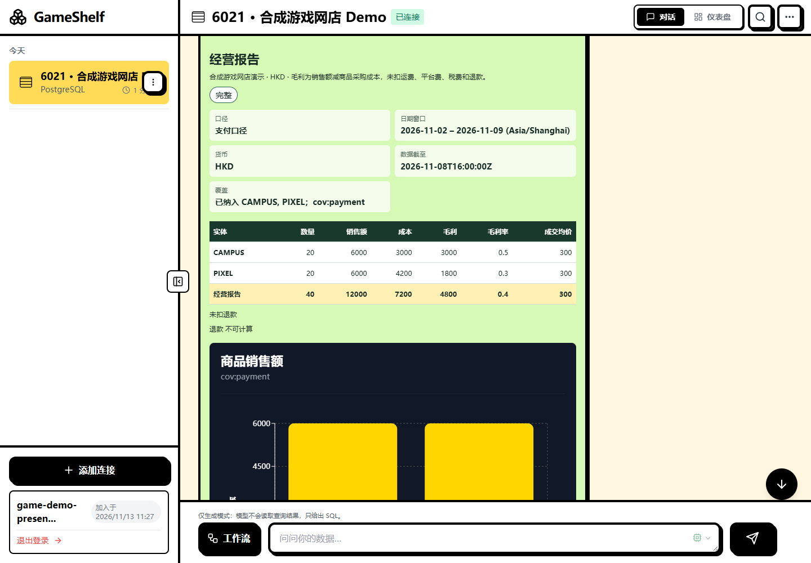
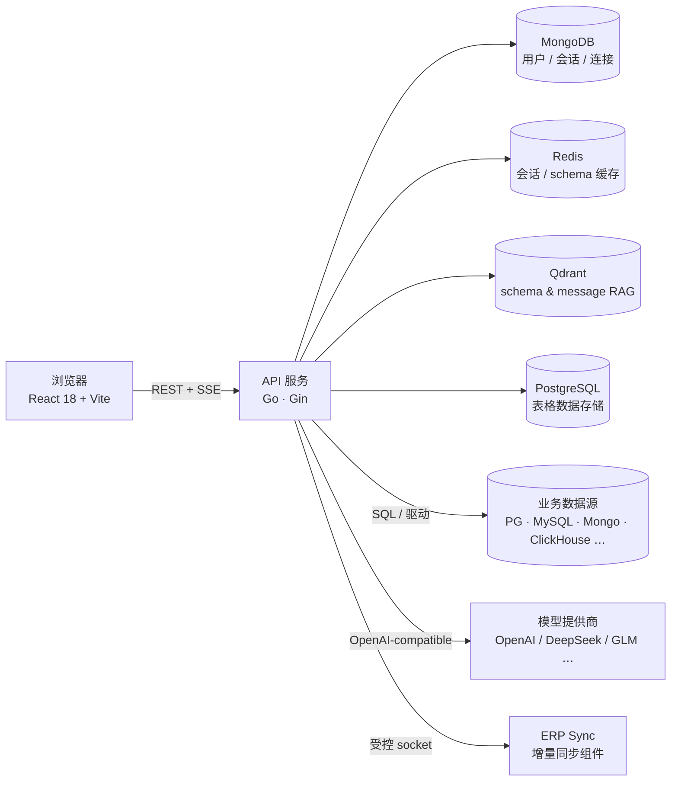
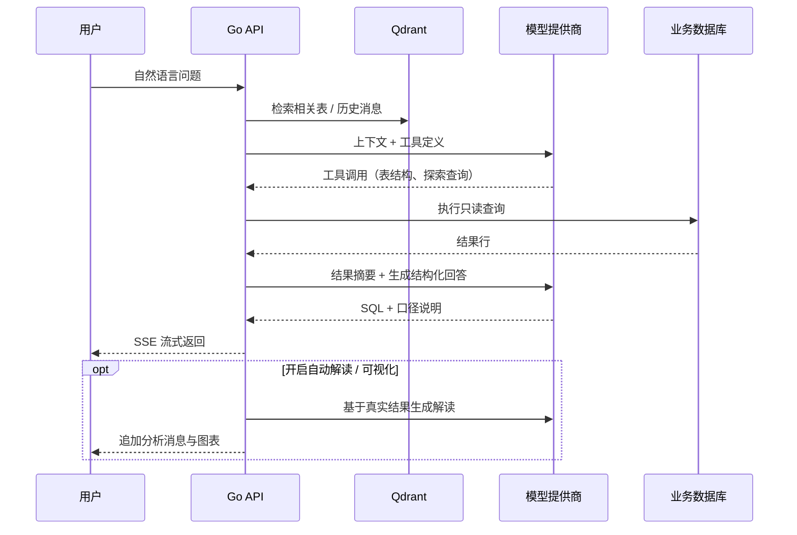

<p align="center">
  
</p>

<p align="center">
  <b>元发问数平台</b> · 用自然语言连接数据库、生成查询、解读结果并沉淀为可视化看板
</p>

<p align="center">
  
  
  
  
</p>

<p align="center">
  <a href="#-功能">功能</a> ·
  <a href="#-架构">架构</a> ·
  <a href="#gameshelf-部署演示">部署演示</a> ·
  <a href="#-快速开始">快速开始</a> ·
  <a href="#-文档">文档</a> ·
  <a href="#-参与贡献">参与贡献</a>
</p>

---

YanfaChatBI 是一个可自托管的 AI 数据问答平台。连接业务数据库后，你可以直接用中文提问，平台会完成 **选表 → 生成查询 → 执行 → 解读结果 → 生成图表** 的完整链路；对话、查询与看板都保留在同一个工作区里。

> 适合需要把「问数」能力部署在自己基础设施上的团队：数据源留在内网，模型可指向云端或自建网关，查询与回滚记录可追溯。

## GameShelf 部署演示

GameShelf 是一个使用合成游戏网店数据的独立演示。它从 PostgreSQL 查询订单，生成两家店铺的销量、销售额、采购成本和毛利对比报表。商品分析不需要模型密钥；体验自由问数时，可在演示环境单独配置模型。

在 Windows 启动 Docker Desktop，从仓库根目录用 PowerShell 执行：

```powershell
./deploy/game-demo/demo.ps1 -Action up-app
./deploy/game-demo/demo.ps1 -Action verify
```

打开 [本地演示](http://localhost:55173)。首次登录、预填案例、使用本机构建依赖的替代流程，以及后续一键启动方式，见 [GameShelf 演示指南](deploy/game-demo/README.md)。



## ✨ 功能

| 能力 | 说明 |
| --- | --- |
| 💬 **对话式问数** | 中文提问，自动生成 SQL / MongoDB 查询并执行；结果分页展示，支持取消与回滚 |
| 🧠 **Agent 工具调用** | 模型按需调用表结构、样例数据、探索查询等工具，先理解数据再回答，而不是凭空生成 |
| 🔎 **RAG 上下文** | 表结构检索可开启 Qdrant BM25，与向量召回通过 RRF 融合；历史消息使用向量检索，长对话可压缩为结构化摘要 |
| 🗂️ **多数据源** | PostgreSQL、TimescaleDB、YugabyteDB、MySQL、StarRocks、ClickHouse、MongoDB、CSV/Excel、Google Sheets |
| 👁️ **PostgreSQL 视图** | 可选择普通表或视图作为查询对象；视图与底表权限隔离，按需开启 |
| 🔌 **自定义模型提供商** | 任意 OpenAI 兼容接口；内置 OpenAI、DeepSeek、智谱 GLM、Moonshot Kimi、MiniMax、通义千问预设 |
| 🎚️ **模型与思考强度** | 每个会话独立选择模型；思考强度用滑块调节，按模型自动映射 `reasoning_effort` / `thinking` 等参数 |
| 📊 **自动可视化** | 查询结果可自动生成折线、柱状、饼图、面积、散点等图表；支持大结果集聚合采样 |
| 📋 **AI 看板** | 用一句话生成看板蓝图，支持 11 类组件：指标卡、表格、折线、柱状、面积、饼图、组合图、仪表盘、条形仪表、热力图、直方图 |
| 🧾 **结果自动解读** | 执行后可追加一段基于真实结果的中文分析，不重复 SQL、不编造数据 |
| 🔄 **数据同步** | ERP 增量同步组件与任务状态、进度、失败重试；同步操作员权限独立管理 |
| 🔐 **自托管与安全** | 管理员账号、注册密钥、Google OAuth；数据源凭据与模型 Key 加密存储；MIT 协议 |

## 🧭 架构



**一次提问的处理流程**



## 🗄️ 支持的数据源

| 数据源 | 状态 | 说明 |
| --- | --- | --- |
| PostgreSQL | ✅ 已支持 | 含视图查询（`QUERY_OBJECTS_ENABLED` 开启） |
| TimescaleDB | ✅ 已支持 | 时序场景 |
| YugabyteDB | ✅ 已支持 | 兼容 PostgreSQL 协议 |
| MySQL | ✅ 已支持 | |
| StarRocks | ✅ 已支持 | |
| ClickHouse | ✅ 已支持 | |
| MongoDB | ✅ 已支持 | 聚合管道与文档结构 |
| CSV / Excel | ✅ 已支持 | 上传后写入独立 PostgreSQL，AES-GCM 加密 |
| Google Sheets | ✅ 已支持 | OAuth 授权接入 |
| Redis / Cassandra / Neo4j | 🚧 规划中 | 欢迎参与实现，见贡献指南 |

## 🤖 模型接入

平台只依赖 **OpenAI 兼容协议**，因此可以自由切换云端或自托管模型：

- 在 **更多 → 对话设置 → 模型提供商** 中新增提供商，填写 `Base URL`、API Key 与模型列表
- 保存前可「测试连接」；创建后可一键刷新模型列表
- 每个模型可配置上下文长度、最大输出、温度与思考强度映射
- 聊天框内直接切换模型与思考强度，设置随会话保存

| 预设 | 默认 Base URL |
| --- | --- |
| OpenAI | `https://api.openai.com/v1` |
| DeepSeek | `https://api.deepseek.com/v1` |
| 智谱 GLM | `https://open.bigmodel.cn/api/paas/v4` |
| Moonshot Kimi | `https://api.moonshot.cn/v1` |
| MiniMax | `https://api.minimax.io/v1` |
| 通义千问 | `https://dashscope.aliyuncs.com/compatible-mode/v1` |

> 也兼容任何自建网关（如 One API、LiteLLM）。模型 Key 使用 AES-GCM 加密后存入 MongoDB，接口只返回掩码。

## 🚀 快速开始

### 环境要求

- Docker 24+ 与 Docker Compose v2
- 可选：Go 1.25+、Node.js 20+（本地开发）

### Docker Compose 启动

```bash
git clone https://github.com/AaYang0312/YanfaChatBI-Public.git YanfaChatBI
cd YanfaChatBI

# 1. 准备配置
cp docker-compose/.env.example docker-compose/.env
#    编辑 docker-compose/.env：至少修改管理员密码、JWT_SECRET、
#    SCHEMA_ENCRYPTION_KEY、SPREADSHEET_DATA_ENCRYPTION_KEY

# 2. 创建共享网络并启动
docker network create yanfachatbi-network
docker compose --env-file docker-compose/.env -f docker-compose/docker-compose-local.yml up -d --build
```

启动完成后访问 **http://localhost:5173**，使用 `.env` 中的 `YANFA_ADMIN_USERNAME` / `YANFA_ADMIN_PASSWORD` 登录。

| 服务 | 地址 |
| --- | --- |
| 前端 | http://localhost:5173 |
| 后端 API | http://localhost:3000 |
| 健康检查 | http://localhost:3000/health |
| MongoDB | localhost:27017 |
| Redis | localhost:6379 |
| 表格 PostgreSQL | localhost:5433 |
| Qdrant | localhost:6333（REST）/ 6334（gRPC） |

### 创建第一个普通用户

注册需要管理员生成的一次性注册密钥：

```bash
curl -X POST http://localhost:3000/api/auth/generate-signup-secret \
  -H 'Content-Type: application/json' \
  -d '{"username":"<admin>","password":"<admin-password>"}'
```

拿到 `secret` 后，在登录页选择注册并填写用户名、邮箱、密码与注册密钥。

### 配置模型

1. 登录后进入 **更多 → 对话设置 → 模型提供商**
2. 选择预设或「自定义」，粘贴 API Key
3. 点击「测试连接」→ 拉取模型 → 保存
4. 回到聊天框，在输入框上方选择模型；支持思考的模型会显示强度滑块

完整参数说明见 [配置参考](docs/CONFIGURATION.md)。

### 启用表结构 BM25 检索

使用 Qdrant 1.20 或更高版本，并已配置 embedding 服务时，可在 `docker-compose/.env` 中设置 `QDRANT_SCHEMA_BM25_ENABLED=true`，再用上面的 Compose 命令应用配置。默认关闭。已有部署请按[配置参考](docs/CONFIGURATION.md#7-嵌入与-rag)完成索引刷新、就绪检查与回滚。

在 60 道中文合成盲测题上，开启 BM25 后，首轮结构证据集齐率保持 **98.3%（59/60）**，平均 Schema 上下文缩减 **13.6%**，检索与上下文组装 P95 均约 **102 ms**。见 [A/B 评测口径与结果](docs/RAG-EVALUATION.md)。

## 📁 项目结构

```text
YanfaChatBI/
├── backend/                 # Go API 服务
│   ├── cmd/                 # API、同步与维护命令入口
│   ├── config/              # 环境变量与校验
│   ├── internal/
│   │   ├── apis/            # 路由、handler、DTO
│   │   ├── services/        # 问数、压缩、可视化、助手、同步
│   │   ├── repositories/    # MongoDB 数据访问
│   │   └── models/          # 领域模型
│   └── pkg/
│       ├── llm/             # OpenAI 兼容客户端、工具、推理注入
│       ├── dbmanager/       # 各数据库方言与执行器
│       ├── vectordb/        # Qdrant 封装
│       └── sourcegate/      # 数据源访问闸门（Linux）
├── client/                  # React + TypeScript 前端
├── docker-compose/          # 本地 / 服务器 / Dokploy 编排
├── deploy/erp-sync/         # ERP 同步组件部署物料
├── docs/                    # 架构、配置、规范与操作手册
```

## 🧪 开发与测试

```bash
# 后端
cd backend
go build ./...
go test ./...

# 前端
cd client
npm ci
npm run dev
npm run lint
npx tsc --noEmit
npm test                 # Vitest
npm run test:browser     # Playwright
```

> `pkg/sourcegate` 使用 Linux 构建标签，完整后端测试请在 Linux / WSL / 容器中运行。

本地开发也可以只启动依赖，再分别运行前后端：

```bash
docker compose -f docker-compose/docker-compose-dependencies.yml up -d
cd backend && go run ./cmd
cd client && npm run dev
```

## 📚 文档

| 文档 | 内容 |
| --- | --- |
| [SETUP.md](SETUP.md) | 本地与服务器部署、首次登录、故障排查 |
| [GameShelf 演示指南](deploy/game-demo/README.md) | 独立部署、示例问题和预期结果 |
| [docs/CONFIGURATION.md](docs/CONFIGURATION.md) | 环境变量、模型、RAG、压缩、同步配置 |
| [docs/ARCHITECTURE.md](docs/ARCHITECTURE.md) | 模块划分、请求链路、数据模型与安全边界 |
| [docs/RAG-EVALUATION.md](docs/RAG-EVALUATION.md) | Schema 检索 A/B 评测口径、指标与局限 |
| [CONTRIBUTING.md](CONTRIBUTING.md) | 开发流程、提交规范、PR 检查清单 |
| [SECURITY.md](SECURITY.md) | 漏洞报告、密钥管理与部署加固 |
| [docs/specs/custom-model-providers.md](docs/specs/custom-model-providers.md) | 模型提供商与思考强度设计 |
| [docs/specs/context-compaction.md](docs/specs/context-compaction.md) | 上下文压缩与结果回灌设计 |
| [docs/specs/view-query-support.md](docs/specs/view-query-support.md) | PostgreSQL 视图查询设计 |
| [docs/erp-sync.md](docs/erp-sync.md) | ERP 增量同步设计与安全边界 |
| [docs/HOW-TO-IMPLEMENT-NEW-DB.md](docs/HOW-TO-IMPLEMENT-NEW-DB.md) | 新增数据库类型 |
| [docs/HOW-TO-IMPLEMENT-NEW-LLM.md](docs/HOW-TO-IMPLEMENT-NEW-LLM.md) | 新增模型提供商 |

## 🗺️ Roadmap

- [ ] Redis / Cassandra / Neo4j 数据源
- [ ] 更多经营指标与行业口径模板
- [ ] 看板分享与只读外链
- [ ] 查询审计与细粒度数据权限
- [ ] 多语言界面（当前为简体中文）

## 🤝 参与贡献

欢迎提交 Issue 与 Pull Request。开始之前请阅读 [CONTRIBUTING.md](CONTRIBUTING.md)；安全问题请按 [SECURITY.md](SECURITY.md) 私下报告，不要公开提交 Issue。

如果这个项目对你有帮助，欢迎点一个 ⭐️。

## 📄 License

本项目基于 [MIT License](LICENSE) 开源。

本项目基于 [NeoBase](https://github.com/bhaskarblur/neobase-ai-dba) 二次开发。
