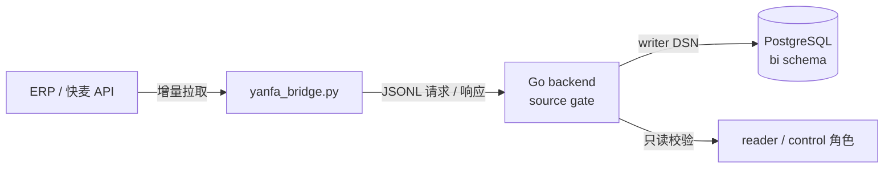

# ERP 增量同步组件

`components/erp-sync` 是 YanfaChatBI 的可选同步组件，用于把 ERP 中的订单与售后数据增量写入 BI 侧 PostgreSQL（`bi` schema），供经营分析与看板使用。

代码保留完整的同步逻辑，但**不包含任何真实密钥**。所有凭据在部署时通过环境变量注入，仓库只记录变量名。

## 目录

```text
components/erp-sync/
├── bi_agent/yanfa_bridge.py   # 与 backend 的桥接协议实现
├── vendor/bi_agent/           # 固定版本的同步实现（catalog / sync / metrics …）
├── tools/package_release.py   # 生成可发布的 bridge 产物
├── tests/                     # 合成数据与协议测试
└── source-input.json          # 版本与成员清单（不含源码内容）
```

## 工作方式



1. backend 通过受控 socket 发送同步请求，包含 source、scope 与水位。
2. bridge 校验 shop 范围与 source 映射，按 ERP 分页接口增量拉取。
3. 写入 `bi` schema 的订单与售后表，并更新同步水位。
4. 完成后返回每个店铺的状态；失败店铺不会推进水位。

设计要点：

- 固定指标与 SQL 模板，不接受任意 SQL
- writer / reader / control 角色分离
- 请求和响应使用有界 JSONL，单帧结束后关闭
- 失败可重试，成功与失败都以落库状态为准

完整说明见 [docs/erp-sync.md](../../docs/erp-sync.md)。

## 配置

生产环境通过外部 secret 注入以下变量，**不要写进仓库或日志**：

| 变量 | 说明 |
| --- | --- |
| `BI_WRITER_DSN` | BI 侧 PostgreSQL 写入连接串 |
| `BI_SHOP_IDS` | 允许同步的店铺 ID 列表（逗号分隔） |
| `KUAI_MAI_APP_KEY` | ERP 应用 Key |
| `KUAI_MAI_APP_SECRET` | ERP 应用 Secret |
| `KUAI_MAI_ACCESS_TOKEN` | ERP 访问令牌 |
| `KUAI_MAI_REFRESH_TOKEN` | ERP 刷新令牌 |

## 本地验证

组件测试使用合成数据，不连接任何真实 ERP 或生产数据库：

```bash
cd components/erp-sync
python -m pytest tests -q
```

如果本地没有安装测试依赖：

```bash
python -m pip install pytest "psycopg[binary]" pydantic sqlglot
```

需要真实数据库的生命周期测试默认跳过，必须显式提供隔离环境变量才会执行。

## 打包

```bash
python tools/package_release.py --help
```

打包只接受 `source-input.json` 中登记的成员与哈希，拒绝额外文件与源码替换。

## 状态

这是一个可复用的同步参考实现。接入其他 ERP 时，需要替换 `vendor/bi_agent/kuaimai.py` 与字段映射，并保持 writer / reader 权限分离。
