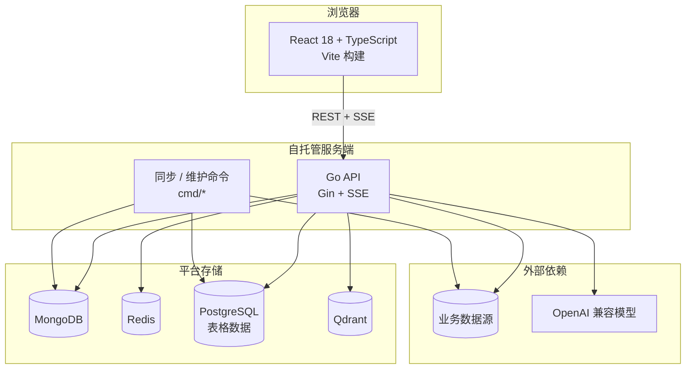
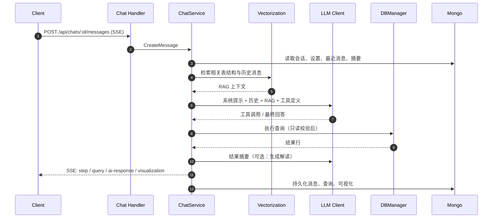
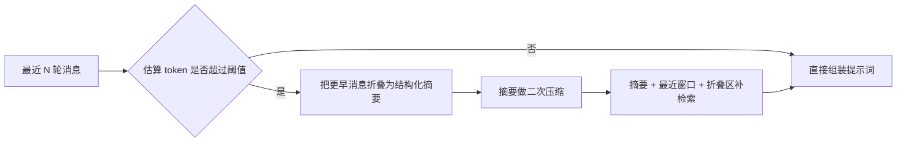

# 架构说明

本文描述 YanfaChatBI 的进程边界、核心模块与关键链路，帮助新贡献者快速定位代码。

## 1. 总览



| 进程 | 入口 | 职责 |
| --- | --- | --- |
| API 服务 | `backend/cmd/main.go` | 认证、会话、问数、可视化、看板、模型提供商、同步任务 |
| 同步/维护命令 | `backend/cmd/erp-*`、`embedding-index-maintenance` | ERP 增量同步、源注册、索引维护 |
| 前端 | `client/` | 单页应用，静态构建后由任意静态服务器托管 |

## 2. 后端分层

```text
internal/apis       路由、中间件、handler、DTO
internal/services   业务编排（问数、压缩、可视化、助手、同步）
internal/repositories  MongoDB 数据访问
internal/models     领域模型
internal/di         依赖注入与启动装配
internal/constants  数据库类型、提示词、模型目录
pkg/llm             OpenAI 兼容客户端、工具、思考参数注入
pkg/dbmanager       各数据库连接、方言、执行与只读判定
pkg/vectordb        Qdrant collection 与检索
pkg/sourcegate      数据源访问闸门（Linux）
pkg/schemaobjects   表 / 视图对象目录
```

约定：

- Handler 只做参数校验与响应封装，不直接访问数据库。
- Service 负责业务规则；跨服务调用通过接口注入，便于测试。
- Repository 封装 MongoDB；业务代码不拼接 BSON 查询。
- `pkg/*` 不依赖 `internal/*`，保证可独立测试。

## 3. 一次对话的链路



关键点：

- **流式协议**：SSE 事件包括执行步骤、查询、回答与可视化；断线不影响已持久化内容。
- **仅生成模式**：会话设置可禁止执行查询，此时不会读取真实数据，提示词会明确告知模型。
- **结果摘要**：进入模型的结果被裁剪为有预算的 digest，避免大结果集撑爆上下文。
- **自动解读**：仅在「自动执行 + 自动解读」同时开启时运行，失败只记录日志，不影响主回答。

## 4. 模型抽象

所有提供商统一走 OpenAI 兼容协议：

```text
ModelProvider (MongoDB)
  ├── base_url
  ├── api_key (AES-GCM)
  └── models[]
        ├── id / display_name
        ├── context_limit / max_completion_tokens / temperature
        └── reasoning spec（参数名、档位、默认值）
```

- `pkg/llm/manager.go` 维护客户端池；提供商变更后重建。
- 模型 ID 使用 `slug/model` 复合形式，解析后路由到对应提供商。
- `pkg/llm/reasoning.go` 通过自定义 HTTP transport 注入思考参数，兼容 `reasoning_effort`、`thinking.type`、`enable_thinking` 等差异。
- 不支持 `response_format` 的网关会自动降级重试，避免结构化输出导致整轮失败。

详见 [模型提供商设计](specs/custom-model-providers.md)。

## 5. RAG 与上下文

### 5.1 向量集合

| Collection | 内容 | 典型过滤 |
| --- | --- | --- |
| `neobase_schema` | 表 / 列 / 描述 | 连接、schema、对象类型 |
| `neobase_messages` | 历史消息 | 会话、角色 |
| `<schema>_objects_v2` | 视图等对象目录 | 连接、对象类型 |

collection 名称是存量数据标识，默认值保持不变；可通过环境变量覆盖，但迁移时必须保持维度一致。

### 5.2 上下文压缩



- 摘要写入 `chat_context_summaries`，使用 revision CAS 防止并发覆盖。
- 数据源变更后摘要标记 stale，剔除结构相关段落。
- 最近窗口有下限，避免压缩到模型无法继续对话。

详见 [上下文压缩设计](specs/context-compaction.md)。

## 6. 数据源访问

`pkg/dbmanager` 按数据库类型实现：

| 能力 | 说明 |
| --- | --- |
| 连接与探活 | 每类数据源独立配置与超时 |
| Schema 读取 | 表、列、索引、视图、样例数据 |
| 查询执行 | 参数化、超时、取消、结果分页 |
| 只读判定 | `SELECT` / `SHOW` / `EXPLAIN` / `VALUES` / `TABLE` 及只读 CTE 可走查询路径 |

- 写操作需要显式确认，并记录回滚信息。
- `pkg/sourcegate` 在 Linux 上串行化数据源访问与同步任务，避免并发写冲突。
- 视图查询不要求底表权限；对象选择需显式包含 `view`。

## 7. 前端结构

```text
client/src/
├── components/        聊天、看板、连接、设置、图表
├── services/          API 客户端与 SSE
├── hooks/             会话、认证、可视化状态
├── i18n/              中文文案与品牌常量
├── types/             API 与领域类型
└── utils/             思考强度、进度、格式化
```

- 品牌名统一从 `i18n/zh-CN` 的 `productName` 读取，禁止在组件中硬编码。
- 聊天设置（模型、思考强度、自动执行/解读）随会话持久化。
- 图表使用 Recharts；看板组件按 `widget_type` 分派。

## 8. 安全边界

| 边界 | 措施 |
| --- | --- |
| 传输 | 生产必须 HTTPS；SSE 关闭代理缓冲 |
| 认证 | JWT Access + Refresh；管理员与普通用户分离 |
| 注册 | 需要管理员生成的一次性注册密钥 |
| 密钥 | 数据源凭据、模型 Key 使用 AES-GCM 加密存储，接口返回掩码 |
| 数据源 | 只读优先；写操作显式确认；视图与底表权限隔离 |
| 同步 | 独立操作员授权；受控 socket，无任意命令执行 |
| 日志 | 不记录完整凭据与模型 Key |

更多加固建议见 [安全说明](../SECURITY.md)。

## 9. 扩展点

| 想做的事 | 入口 |
| --- | --- |
| 新增数据库类型 | [HOW-TO-IMPLEMENT-NEW-DB.md](HOW-TO-IMPLEMENT-NEW-DB.md) |
| 新增模型提供商/模型 | [HOW-TO-IMPLEMENT-NEW-LLM.md](HOW-TO-IMPLEMENT-NEW-LLM.md) |
| 调整提示词与工具 | `backend/internal/constants/`、`backend/pkg/llm/tools.go` |
| 新增看板组件 | `client/src/components/dashboard/widgets/`、`client/src/types/dashboard.ts` |
| 新增同步数据源 | `backend/internal/services/data_sync_service.go`、`backend/cmd/erp-*` |
