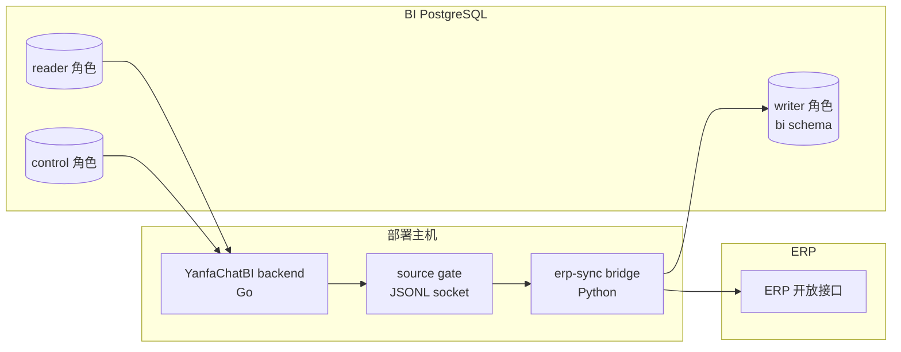

# ERP 增量同步设计

YanfaChatBI 除了直接连接业务数据库，也支持通过独立的同步组件把 ERP 数据落到 BI 侧 PostgreSQL，再由聊天与看板查询。本文说明这条链路的设计与安全边界。

> 该组件是可选的，不启动也不影响问数主流程。仓库中的实现以快麦 ERP 为参考适配。

## 1. 目标

- 按店铺增量同步订单与售后数据
- 不把 ERP 凭据写入业务数据库或前端
- 失败可重试，重复执行不产生重复数据
- 同步过程中不阻塞在线问数
- 可以证明“同步到哪一天、哪些店铺成功”

## 2. 组件



| 角色 | 职责 |
| --- | --- |
| backend | 创建同步任务、维护 source 与 scope、调用 bridge、记录状态 |
| source gate | 只允许受控请求；校验 source、scope 与水位 |
| bridge | 调用 ERP API、转换数据、写入 `bi` schema |
| writer | 只写 `bi` schema |
| reader | 只读校验结果 |
| control | 获取 advisory lock，防止并发同步 |

## 3. 同步流程

1. backend 读取已登记的 source，冻结本次 shop 范围与起始水位。
2. 通过 socket 发送 `sync` 请求，包含 `source`、`scope_digest`、`expected_shop_ids`。
3. bridge 校验请求与配置文件一致后，按店铺拉取增量数据。
4. 在一个事务中写入订单 / 售后记录并更新水位。
5. 返回每个店铺的状态；backend 记录 job 结果并在前端展示进度。
6. 失败店铺保留原水位，可单独重试；成功店铺不会因其他店铺失败而回滚。

## 4. 数据与幂等

- 订单与售后都有业务主键，写入使用 upsert。
- 水位只在对应店铺成功后推进。
- 请求带 `request_id`，重复请求返回同一结果。
- 同步任务状态与日志只记录安全摘要，不记录凭据或完整行数据。

## 5. 凭据与权限

仓库不包含任何真实密钥。部署时通过 secret 注入：

| 变量 | 用途 |
| --- | --- |
| `BI_WRITER_DSN` | 写入 BI PostgreSQL |
| `BI_SHOP_IDS` | 允许同步的店铺范围 |
| `KUAI_MAI_APP_KEY` | ERP 应用 Key |
| `KUAI_MAI_APP_SECRET` | ERP 应用 Secret |
| `KUAI_MAI_ACCESS_TOKEN` | ERP 访问令牌 |
| `KUAI_MAI_REFRESH_TOKEN` | ERP 刷新令牌 |

要求：

- writer / reader / control 使用不同角色，最小权限
- 凭据只存在于部署主机的受保护环境文件或 secret manager
- 日志与错误信息对 DSN、token、店铺标识做脱敏
- 前端只能看到同步状态与安全错误码，不能读取连接串

## 6. 失败处理

| 情况 | 行为 |
| --- | --- |
| ERP 限流或超时 | 当前店铺失败，保留水位，任务可重试 |
| 数据校验失败 | 整批回滚，不推进水位 |
| bridge 进程退出 | 任务标记失败，已提交批次不回滚 |
| 并发同步 | control 角色的 advisory lock 阻止第二个任务 |
| 店铺范围不一致 | 拒绝请求，不执行任何写入 |

## 7. 本地验证

组件测试使用合成数据和本地合成库，不访问真实 ERP：

```bash
cd components/erp-sync
python -m pytest tests -q
```

真实数据库生命周期测试需要显式开启隔离环境，默认跳过。

## 8. 扩展

接入其他 ERP 时：

1. 在 `components/erp-sync/vendor/bi_agent/` 中实现新的 API 客户端与字段映射。
2. 保持 `yanfa_bridge.py` 的请求 / 响应协议不变。
3. 为 writer / reader / control 分别创建最小权限角色。
4. 用合成数据补齐幂等、失败重试与并发测试。
